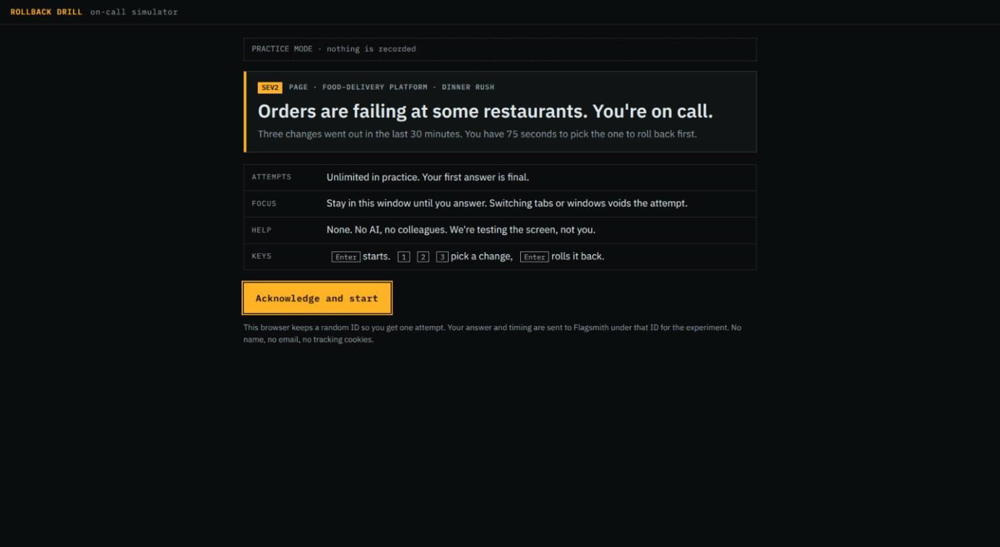
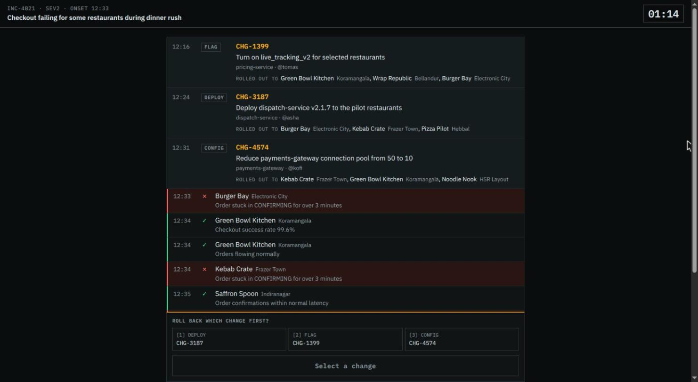
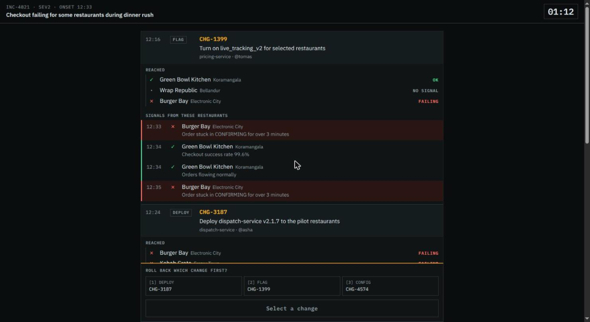
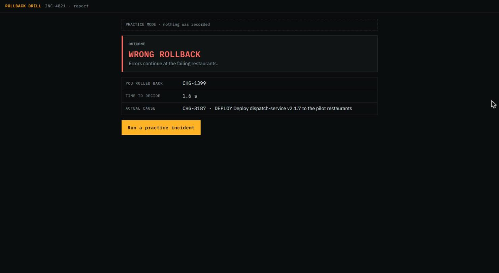

# Rollback Drill

**A 75-second on-call drill that is also a live A/B test.**

Orders are failing at some restaurants and three changes just shipped. You pick the one to roll
back first. Flagsmith Experimentation decides how the evidence is laid out for you, and measures
whether that layout helps people make the right call.

[](https://github.com/Mounesh-S/rollback-drill/actions/workflows/ci.yml)


Built for **[Toggle Wars: the Flagsmith Experimentation Hackathon](https://www.wemakedevs.org/hackathons/flagsmith)**,
Track 01 *Test Something Real*.

| Resource | Link |
|---|---|
| **Play it** | https://rollback-drill-ebon.vercel.app |
| **Try either layout (judges / practice, nothing recorded)** | [grouped](https://rollback-drill-ebon.vercel.app/?practice=1&layout=grouped&seed=4821) · [chronological](https://rollback-drill-ebon.vercel.app/?practice=1&layout=chronological&seed=4821) |
| **Demo video** | _YouTube link added after upload_ |
| **Results** | [docs/RESULTS.md](docs/RESULTS.md) |
| **Pre-registered plan** | [docs/PREREGISTRATION.md](docs/PREREGISTRATION.md) |



## The problem

When something breaks in production, the on-call engineer usually stares at a timeline of
deploys, flag changes, config changes and alerts, sorted by time. The change that shipped just
before the errors looks guilty, but it often isn't. The real question is **which change reached
exactly the customers who are failing**, and a time-ordered feed makes that hard to see.

Rollback Drill turns that moment into a 75-second game and uses Flagsmith to test a better screen.

## The experiment

| Part | Design |
|---|---|
| **Hypothesis** | Showing evidence grouped by change, with the status of every restaurant each change reached, raises the share of correct first rollbacks |
| **Control** | `chronological`: one time-ordered log, like most incident timelines |
| **Treatment** | `grouped`: the same evidence grouped by change, each reached restaurant labelled OK / FAILING / NO SIGNAL (derived from the same signals) |
| **Primary metric** | `correct_first_rollback`: first answer correct, within the time limit, without leaving the drill window |
| **Secondary** | `decision_time_ms`: mean time to the first answer |
| **Guardrails** | `decision_submitted` must not drop; `tab_left` must not rise |
| **Reporting only** | `self_reported_help`: players who say they had outside help |
| **Decision rule** | Roll out `grouped` only if its chance to beat control is above 95% on the primary metric |

| Control: chronological | Treatment: grouped by change |
|---|---|
|  |  |

Same incident (`seed=4821`), same evidence, two layouts. The full plan, sample size, stopping
rule and limitations were committed before launch: [docs/PREREGISTRATION.md](docs/PREREGISTRATION.md).

## Results

Flagsmith experiment 567 has run in Production with real players since Nov 26, 2026, 21:17 IST.
Code is frozen at tag [`experiment-v1`](https://github.com/Mounesh-S/rollback-drill/tree/experiment-v1).
Full table, raw export and reasoning: [docs/RESULTS.md](docs/RESULTS.md).

| Real players (Nov 28, 21:23 IST) | `chronological` (control) | `grouped` (treatment) |
|---|---|---|
| Players exposed | 5 | 10 |
| Correct first rollback (primary) | 2/5 (40%) | 2/10 (20%) |
| Answered in time (guardrail) | 4/5 (80%) | 4/10 (40%) |
| Left the window (guardrail) | 1/5 (20%) | 3/10 (30%) |
| Sample ratio check | p = 0.197, balanced | |

**Verdict by the pre-registered rule: not enough data, keep `chronological`.** The rule needs at
least 50 players per arm. Below that, any difference is noise, and calling a winner (or a loser)
would be a guess. The window closes on Nov 29, 12:00 IST, when the experiment is completed in
Flagsmith with `rollout_decision: control`. `npm run report` applies the rule to any export.

The method itself was proven before launch with 400 simulated players in a separate Development
environment ([docs/VALIDATION.md](docs/VALIDATION.md)):

| Validation run | What it proves | Outcome |
|---|---|---|
| A/A (no real difference) | No false winner on the primary metric | 74% chance to win, no winner ✅ |
| Known effect (40% vs 70%) | A real effect is detected | 96.9% chance to win, winner ✅ |
| Rollout rehearsal | "Ship the winner" works with the same flag | Every new player got `grouped` ✅ |
| Sample ratio check | Assignment is balanced | p = 0.29 and 0.42, no mismatch ✅ |



## How Flagsmith is used

Flagsmith is not a side feature here: it assigns every player, records every exposure, receives
every outcome, computes the result and ships the winner.

| Flagsmith feature | How it is used |
|---|---|
| **Multivariate flag** `incident_evidence_layout` | Holds both layouts; the app renders `grouped` only for that variant ([ExperimentEvidence.tsx](src/flags/ExperimentEvidence.tsx)) |
| **Experimentation** | 50/50 split, 5 metrics, Bayesian results, `complete` to keep control or roll out the winner |
| **Identities** | Each browser gets a random UUID (no personal data), so assignment is stable and exposures join to outcomes |
| **Events** | Four typed game events feed the five metrics and are flushed immediately ([track.ts](src/flags/track.ts)) |
| **Kill switch** `game_enabled` | Turns the drill off with a maintenance screen, without touching the locked experiment flag |
| **Remote config** `drill_config` | Sets the timer (frozen once the experiment starts) |
| **CLI and API** | Everything was created and is operated with the Flagsmith CLI: [docs/FLAGSMITH-SETUP.md](docs/FLAGSMITH-SETUP.md) |

The exposure is recorded at the exact moment a player sees a layout:

```tsx
// src/flags/ExperimentEvidence.tsx: rendered only after the player presses Start
export function ExperimentEvidence({ incident }: { incident: Incident }) {
  const flag = useExperiment(FLAG.layout) // records the exposure on render
  return flag?.variant === 'grouped' ? <Grouped incident={incident} /> : <Chronological incident={incident} />
}
```

Two details matter for correct data:

- **Server flags only.** Flagsmith records exposures only for flags loaded from the server, so
  caching is off and the drill cannot start until server flags arrive
  ([LiveRoot.tsx](src/flags/LiveRoot.tsx)).
- **Metrics are fixed at creation.** Flagsmith does not allow changing an experiment's metrics
  later, so all five are attached when the experiment is created.

## Making the test fair

- **No shortcuts.** Every incident has exactly one correct answer, and its structure is symmetric:
  every pair of changes shares one restaurant, every change reaches one silent restaurant, and time
  slots, change types and ids are random. Guessing by timing, overlap or ids scores about 33% (chance)
  over 20,000 incidents; reading the signals scores 100%. Both are enforced by tests.
- **Evidence parity.** A CI test renders both layouts for 500 incidents and fails if either drops or
  invents any change or signal ([parity.test.tsx](src/layouts/parity.test.tsx)).
- **Unique incident per player,** so a shared answer, or an AI's answer, is useless to anyone else.
- **One attempt per browser, across tabs.** Reloading mid-round counts as abandoned; a second tab can
  neither start another round nor see the answer.
- **Leaving the drill window voids the attempt** (hidden tab or window blur).
- **Simulated traffic never touches Production.** The simulator only accepts allowlisted
  Development keys.

## Run it locally

Requirements: Node 22.18 or newer, and a Flagsmith project (the free Cloud plan works).

```bash
git clone https://github.com/Mounesh-S/rollback-drill.git
cd rollback-drill
npm ci
cp .env.example .env               # add your Flagsmith client-side environment key
npm run dev                        # http://localhost:5173
```

Open `http://localhost:5173/?practice=1` to play without Flagsmith.

Set up the flags, metrics and experiment with the commands in
[docs/FLAGSMITH-SETUP.md](docs/FLAGSMITH-SETUP.md).

| Command | What it does |
|---|---|
| `npm run check` | Typecheck, lint and 1,100+ tests (including accessibility and contrast audits) |
| `npm run validate-scenarios` | Proves every scenario pack generates solvable incidents |
| `npm run coverage` | Test coverage report |
| `SIM_ENV_KEY=<dev key> npm run simulate -- --run aa-1 --users 400 --control 0.5 --treatment 0.5` | Simulated players through the real SDK (Development only) |
| `npm run srm -- results.json` | Sample-ratio-mismatch check on exported results |
| `npm run report -- results.json` | Results table and the verdict from the pre-registered decision rule |

## Run this drill with your own team

Incidents come from plain JSON **scenario packs** in [scenarios/](scenarios/): services, tenants,
change titles and symptoms. Write a pack, run `npm run validate-scenarios`, and register it in
`src/game/packs.ts`. See [scenarios/README.md](scenarios/README.md).

## Project layout

```
src/game/      incident generator, solver, round state machine, events
src/layouts/   the two evidence layouts and the parity test
src/screens/   intro, play, result and status screens
src/flags/     Flagsmith: provider, experiment evidence, events, kill switch, config
scripts/       scenario validator, traffic simulator, SRM check
docs/          pre-registration, Flagsmith setup, validation, decision log, how it works
```

## Docs

| Document | What's in it |
|---|---|
| [RESULTS.md](docs/RESULTS.md) | Real-player results, the verdict and the decision |
| [PREREGISTRATION.md](docs/PREREGISTRATION.md) | Hypothesis, metrics, sample size, stopping and decision rules, amendments |
| [FLAGSMITH-SETUP.md](docs/FLAGSMITH-SETUP.md) | Exact CLI and API commands |
| [VALIDATION.md](docs/VALIDATION.md) | A/A, known-effect and rollout tests, with raw Flagsmith results |
| [DECISIONS.md](docs/DECISIONS.md) | Every change to flags, metrics and experiments, with reasons |
| [HOW-IT-WORKS.md](docs/HOW-IT-WORKS.md) | A walk through the code in the order a round happens |

## Built with

React 19, TypeScript, Vite, the Flagsmith JavaScript SDK (`@flagsmith/flagsmith` 12.6.0) and CLI,
Vitest, Testing Library, axe-core, IBM Plex fonts (self-hosted), and Vercel.

## Notes

- Built with help from an AI coding assistant. Every file is small, commented and explained in
  [docs/HOW-IT-WORKS.md](docs/HOW-IT-WORKS.md).
- All restaurants, people and services are fictional.
- Licensed under [MIT](LICENSE).
